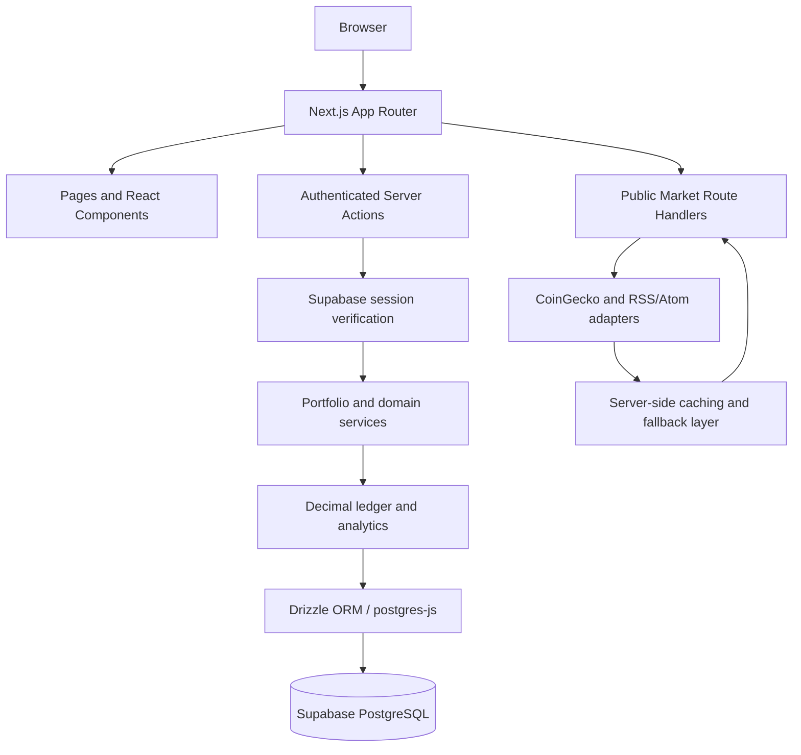

# Crypto Portfolio Tracker

A full-stack cryptocurrency portfolio management and market-information application for recording holdings, tracking portfolio performance, and exploring cryptocurrency market data.


> **Product boundary:** Crypto Portfolio Tracker is a portfolio-management and decision-support application. It is not a custodial wallet, broker, exchange, automated trading engine, or tax-preparation system. It does not require users to provide wallet seed phrases or private keys for its core workflow.

---

## Contents

- [Overview](#overview)
- [Capabilities](#capabilities)
- [Technology stack](#technology-stack)
- [Architecture](#architecture)
- [Application routes](#application-routes)
- [HTTP API](#http-api)
- [Portfolio accounting model](#portfolio-accounting-model)
- [Database](#database)
- [Security model](#security-model)
- [Getting started](#getting-started)
- [Environment configuration](#environment-configuration)
- [Development commands](#development-commands)
- [Testing](#testing)
- [Database migrations](#database-migrations)
- [Deployment](#deployment)
- [Known limitations and future work](#known-limitations-and-future-work)
- [Documentation](#documentation)
- [Contributing](#contributing)
- [Security reporting](#security-reporting)

## Overview

Crypto Portfolio Tracker centralizes user-maintained cryptocurrency positions and market information in one web application. It combines portfolio management, transaction history, market discovery, watchlists, alert configuration, news aggregation, and analytics.

The application is implemented as a **Next.js App Router** project. The browser-facing interface, server-rendered pages, HTTP Route Handlers, and authenticated Server Actions are maintained in one application. Supabase provides authentication and PostgreSQL hosting; Drizzle ORM provides typed database access and versioned schema migrations.

The system emphasizes:

- explicit user and portfolio ownership;
- transaction-ledger-based position reconstruction;
- decimal arithmetic for financial calculations;
- transactional consistency and per-portfolio mutation locking;
- clear separation between public market data and private user data;
- documented database, API, security, and operational boundaries.

## Capabilities

### Portfolio management

- Maintain a user's cryptocurrency holdings and position details.
- Record purchases and sales in a transaction ledger.
- Correct a position through an adjustment event without deleting earlier trade history.
- Reconstruct the current holding from the ordered ledger.
- View portfolio value and unrealized performance using current market prices.

### Market discovery

- Browse normalized cryptocurrency market listings.
- View aggregate market statistics and dominance metrics.
- View trending assets.
- Use market-data fallbacks when an upstream provider is unavailable.

### Portfolio analytics

- Review current portfolio value, cost basis, and profit/loss.
- Compare the performance of current holdings.
- Review net invested value derived from recorded buys and sells.
- View monthly buy/sell activity and cumulative net investment.

The analytics distinguish current unrealized position performance from cash-flow activity. The transaction ledger alone is not a historical portfolio-valuation snapshot system.

### Watchlist and alerts

- Maintain a user-owned watchlist of tracked assets.
- Create and manage stored price-alert configurations.

An alert configuration being stored does not, by itself, imply that a continuously running scheduler, email sender, or push-notification worker is deployed. See [Capabilities and limitations](docs/product/capabilities-and-limitations.md).

### News

- Aggregate cryptocurrency news from configured RSS/Atom sources.
- Normalize feed records into a common article representation.
- Remove duplicate article URLs and order articles by publication time.
- Tolerate partial provider failures and use fallback content when all configured feeds fail.

## Technology stack

| Area | Technology | Responsibility |
|---|---|---|
| Application framework | Next.js 16 App Router | Pages, layouts, Route Handlers, Server Actions, request proxy |
| UI runtime | React 19, TypeScript | Typed application and component implementation |
| Styling | Tailwind CSS 4 | Responsive interface styling |
| Authentication | Supabase Auth, `@supabase/ssr` | Browser/server authentication and cookie-aware sessions |
| Database | Supabase PostgreSQL | User profiles, portfolios, holdings, transactions, watchlists, alerts |
| ORM and migrations | Drizzle ORM, Drizzle Kit | Typed schema, SQL generation, migration history |
| PostgreSQL driver | `postgres` (postgres-js) | Server-side database connectivity |
| Validation | Zod, React Hook Form | Form input validation and action contracts |
| Financial arithmetic | `decimal.js` | Decimal-safe monetary and quantity calculations |
| Client data state | TanStack Query, Axios | Client query state and HTTP requests where used |
| Market data | CoinGecko API | Market listings, global statistics, trending data |
| News data | RSS/Atom feeds | Aggregated market-news records |
| Visualizations | Chart.js, `react-chartjs-2` | Portfolio and market charts |
| UI utilities | Lucide React, Framer Motion, `next-themes`, `date-fns` | Icons, animation, theme, date handling |
| Tests | Node test runner through `tsx` | Unit, analytics, and PostgreSQL integration tests |

The installed package versions in `package.json` and `package-lock.json` are authoritative. This table describes the current application architecture rather than prescribing versions independently of the lockfile.

## Architecture

### High-level design



### Main code areas

| Path | Responsibility |
|---|---|
| `src/app/` | App Router pages, layouts, and HTTP Route Handlers |
| `src/components/` | Shared UI and feature components |
| `src/db/schema.ts` | Drizzle table, relation, index, and constraint definitions |
| `src/lib/actions/` | Server Actions for authenticated user-owned mutations |
| `src/lib/analytics/` | Analytics calculations over loaded portfolio data |
| `src/lib/api/` | External market/news adapters and normalization |
| `src/lib/auth/` | Current-user and session helpers |
| `src/lib/db/` | Server-only Drizzle/PostgreSQL client |
| `src/lib/portfolio/` | Portfolio queries, decimal helpers, ledger replay, locking, holding recomputation |
| `src/lib/supabase/` | Browser and request-scoped Supabase clients |
| `src/types/` | Shared TypeScript domain types |
| `src/utils/` | Formatting and shared utility functions |
| `src/proxy.ts` | Next.js 16 request interception entry point |
| `drizzle/` | SQL migrations, snapshots, and migration journal |
| `tests/` | Ledger, analytics, and database integration tests |
| `docs/` | Architecture, API, database, security, development, and operations documentation |

Portfolio mutations are **Server Actions**, not a separately deployed REST backend. The HTTP API currently exposed by Route Handlers is focused on public market and news information.

## Application routes

The current production build exposes these application routes:

| Route | Purpose |
|---|---|
| `/` | Dashboard |
| `/portfolio` | Portfolio and transaction management |
| `/analytics` | Portfolio analytics and visualizations |
| `/markets` | Cryptocurrency market discovery |
| `/news` | Aggregated cryptocurrency news |
| `/watchlist` | User watchlist |
| `/alerts` | Alert configuration management |
| `/settings` | User settings |
| `/onboarding` | Initial profile setup |
| `/login` | Authentication entry |
| `/signup` | Account registration |

The exact page composition and access behaviour are defined by the current source under `src/app/` and the request proxy.

## HTTP API

The currently documented HTTP API is GET-only and provides public market/news information. Portfolio, profile, watchlist, alert, and holding mutations are implemented through authenticated Server Actions.

Base URL for local development: `http://localhost:3000`.

| Method and path | Purpose | Route revalidation |
|---|---|---:|
| `GET /api/crypto/global` | Aggregate market statistics | 120 seconds |
| `GET /api/crypto/markets` | Normalized market coin list | 60 seconds |
| `GET /api/crypto/trending` | Trending assets | 300 seconds |
| `GET /api/crypto/news` | Aggregated RSS/Atom news | 300 seconds |

### Query parameters

`GET /api/crypto/markets`

| Parameter | Default | Description |
|---|---:|---|
| `vs_currency` | `usd` | Quote currency |
| `per_page` | `100` | Requested page size, clamped to 1–250 |
| `page` | `1` | Page number, minimum 1 |
| `ids` | omitted | Comma-separated provider asset IDs |
| `sparkline` | `false` | Request sparkline data when set to `true` |

`GET /api/crypto/news`

| Parameter | Default | Description |
|---|---:|---|
| `limit` | `30` | Number of articles, clamped to 1–50 |

The global and trending endpoints currently require no query parameters.

### Response envelope and fallback behaviour

Market endpoints use a normalized response envelope similar to:

```json
{
  "data": "<route-specific payload>",
  "meta": {
    "source": "live",
    "fetchedAt": "2026-11-19T08:00:00.000Z",
    "count": 1
  }
}
```

`meta.source` identifies whether the route used live upstream data or local fallback data. A successful HTTP response can contain fallback data when an upstream service is unavailable. Clients that need to communicate freshness should inspect this metadata.

Examples:

```bash
curl http://localhost:3000/api/crypto/global
curl "http://localhost:3000/api/crypto/markets?vs_currency=usd&per_page=50&page=1"
curl http://localhost:3000/api/crypto/trending
curl "http://localhost:3000/api/crypto/news?limit=20"
```

For the full endpoint contract, fields, cache behaviour, and error handling, see [API Reference](docs/api/reference.md).

## Portfolio accounting model

The transaction ledger is the source of truth. The `holdings` table is a derived projection reconstructed from the ordered transactions for a user, portfolio, and asset.

### Supported ledger events

| Event | Effect on quantity | Effect on acquisition cost | Cash-flow analytics |
|---|---|---|---|
| `buy` | Adds quantity | Adds recorded acquisition value | Included as an investment outflow |
| `sell` | Removes quantity | Removes cost at the weighted-average basis before the sale | Included as proceeds |
| `adjustment` | Replaces quantity with the corrected absolute quantity | Resets cost to the correction's recorded value | Excluded |

An adjustment is a correction event, not a purchase or sale. It preserves earlier transaction history. An adjustment with zero quantity closes the current holding projection without deleting its ledger history.

### Weighted-average cost

For each SELL, the ledger removes the quantity multiplied by the average acquisition cost immediately before that sale. Sale proceeds are not subtracted from the remaining holding cost basis.

The analytics keep two concepts separate:

- **Net cash invested:** recorded BUY values minus recorded SELL proceeds.
- **Unrealized position P&L:** current holding value minus remaining holding cost basis.

The ledger uses weighted-average cost; it is not a FIFO or specific-identification tax-lot engine.

### Precision and deterministic replay

| Value | PostgreSQL type |
|---|---|
| Quantity | `NUMERIC(28,8)` |
| Unit price and holding cost basis | `NUMERIC(20,8)` |
| Transaction total value | `NUMERIC(48,16)` |

Financial values are parsed from strings with `decimal.js`, avoiding premature conversion through JavaScript binary floating-point numbers. Transaction totals retain 16 fractional places because multiplying two scale-8 values can require 16 decimal places.

Ledger replay is ordered by `executed_at`, then by the database-generated unique `ledger_sequence` for events with equal timestamps. Every mutation locks the owning portfolio row, writes the ledger event, replays the position, and updates or removes the holding within one PostgreSQL transaction.

See [Ledger Accounting](docs/database/ledger-accounting.md) for the complete rules and examples.

## Database

The application uses Supabase PostgreSQL with Drizzle ORM. The main application tables are:

| Table | Purpose |
|---|---|
| `profiles` | Application profile associated with a Supabase Auth user |
| `portfolios` | User-owned portfolio records |
| `holdings` | Current position projections |
| `transactions` | BUY, SELL, and ADJUSTMENT ledger events |
| `watchlist_items` | User-owned asset watchlist entries |
| `alerts` | User-owned price-alert configurations |

Ownership is represented using the authenticated user ID and portfolio relationships. The schema also contains indexes, foreign keys, unique constraints, and Row-Level Security policies. The exact definitions are maintained in `src/db/schema.ts` and the versioned SQL files under `drizzle/`.

**Important database boundary:** the server-side Drizzle connection uses a privileged database role that can bypass RLS. Therefore RLS is not the only authorization layer for application queries. Every user-facing privileged Drizzle query must explicitly scope records to the verified session's user ID.

The database migration history currently includes `0005_transaction-adjustment-events` and `0006_transaction-total-precision` for the deterministic event sequence, transaction constraints, and scale-16 transaction totals.

Detailed references:

- [Database schema reference](docs/database/schema-reference.md)
- [Migration guide](docs/database/migrations.md)
- [RLS and privileges](docs/database/rls-and-privileges.md)

## Security model

The application applies layered controls:

1. Verify the Supabase session on protected server operations.
2. Derive user identity from the verified session; do not trust a browser-supplied `userId` as authorization.
3. Validate Server Action input at the server boundary.
4. Scope privileged database queries explicitly by owner and relevant resource IDs.
5. Keep RLS policies enabled as a database-side protection layer for supported authenticated access paths.
6. Use database constraints and foreign keys to protect data invariants.
7. Keep database connection strings and provider credentials on the server.
8. Execute ledger writes and holding recomputation atomically under a portfolio lock.

The application does not need wallet seed phrases or private keys for its core tracking workflow. API credentials must not be exposed via `NEXT_PUBLIC_*` environment variables. Never commit `.env.local` or production secrets.

Security details, trust boundaries, and reporting guidance:

- [Security overview](docs/security/overview.md)
- [Threat model](docs/security/threat-model.md)
- [Access-control matrix](docs/security/access-control-matrix.md)
- [Security policy](SECURITY.md)

## Getting started

### Prerequisites

- Node.js version compatible with the project toolchain (the verified development environment used Node.js 24.x).
- npm.
- A Supabase project with Auth and PostgreSQL configured.
- A database connection string with permissions appropriate for the server-side Drizzle migrations and application queries.
- Optional CoinGecko Demo API credentials if required by the configured provider plan.

### Clone and install

```bash
git clone https://github.com/Jeremiahogingo/crypto-portfolio-tracker.git
cd crypto-portfolio-tracker
npm install
```

### Configure environment

Create `.env.local` in the repository root. The current application configuration uses:

```dotenv
# Supabase project configuration
NEXT_PUBLIC_SUPABASE_URL=
NEXT_PUBLIC_SUPABASE_ANON_KEY=

# Server-only PostgreSQL connection for Drizzle
DATABASE_URL=

# Optional CoinGecko configuration
COINGECKO_BASE_URL=https://api.coingecko.com/api/v3
COINGECKO_DEMO_API_KEY=
```

Use the values from the intended Supabase project. `DATABASE_URL` and provider credentials are server-only values. Do not prefix them with `NEXT_PUBLIC_`.

The exact environment contract and local setup notes are maintained in [Development Setup](docs/development/setup.md). Do not commit `.env.local`.

### Start the development server

```bash
npm run dev
```

Open `http://localhost:3000` in a browser. Complete signup and onboarding to create an application profile and default portfolio before using portfolio-dependent workflows.

## Development commands

| Command | Purpose |
|---|---|
| `npm run dev` | Start the Next.js development server |
| `npm run build` | Create the optimized production build |
| `npm run start` | Start the production server after a successful build |
| `npm run lint` | Run the configured ESLint command |
| `npx tsc --noEmit` | Run TypeScript type checking |
| `npm test` | Run ledger unit and analytics regression tests |
| `npm run test:db` | Run PostgreSQL-backed ledger integration tests |
| `npm audit --omit=dev` | Audit production dependencies |

## Testing

The repository has two test suites:

### Unit and analytics tests

```bash
npm test
```

These cover decimal parsing and formatting, BUY/SELL/ADJUSTMENT replay, weighted-average cost, precision boundaries, zero-quantity corrections, oversell handling, and the exclusion of adjustments from cash-flow analytics.

### PostgreSQL integration tests

```bash
npm run test:db
```

The integration suite requires `DATABASE_URL` and an existing portfolio. It exercises the real database schema and Drizzle integration, including sequence ordering, adjustment replay, scale-16 values, oversell rollback, and adjustment-deletion rollback.

The integration suite uses temporary coin identifiers and explicitly rolls back test transactions. It may briefly acquire a lock on an existing portfolio and consumes PostgreSQL sequence values even when the enclosing transaction rolls back. Sequence gaps are expected. Run it against a dedicated development or staging database rather than a busy production database.

### Additional quality checks

```bash
npx tsc --noEmit
npx eslint src tests
npm run build
npm audit --omit=dev
```

See [Testing Strategy](docs/development/testing.md) for detailed coverage and test-environment guidance.

## Database migrations

The Drizzle schema is defined in `src/db/schema.ts`; migration SQL and snapshots are stored in `drizzle/`.

Generate a migration after changing the schema:

```bash
npx drizzle-kit generate --name=describe-the-change
```

Review the generated SQL and snapshot before applying it. Apply migrations using:

```bash
npx drizzle-kit migrate
```

Do not use `drizzle-kit push` as a substitute for reviewed production migration history. Back up the target database according to the deployment procedure before applying production schema changes.

See [Database Migrations](docs/database/migrations.md).

## Deployment

The application can be deployed to a Next.js-compatible Node hosting environment. A deployment requires the environment variables for the intended Supabase project, a reachable PostgreSQL connection for Drizzle, and any optional provider credentials.

Recommended release sequence:

1. Review application and database changes.
2. Back up the database or verify the managed backup/restore procedure.
3. Apply reviewed Drizzle migrations to the target environment.
4. Deploy the application build with the matching environment configuration.
5. Verify authentication, database connectivity, public market routes, and a controlled portfolio workflow.
6. Inspect logs, upstream provider status, and fallback-source metadata.

Do not run a schema migration from an unreviewed local working tree against production. Keep secrets in the hosting provider's secret store. See [Deployment](docs/operations/deployment.md), [Runbooks](docs/operations/runbooks.md), and [Backup and Restore](docs/operations/backup-and-restore.md).

## Known limitations and future work

The following boundaries should be understood when interpreting application output:

- Market data is cached provider data, not a guaranteed real-time exchange feed.
- Market and news routes may return local fallback data when an upstream service fails; inspect `meta.source` when freshness matters.
- The current transaction ledger supports weighted-average cost, not tax-lot accounting such as FIFO or specific identification.
- Transaction records alone do not provide historical daily portfolio valuations. That requires stored position and/or price snapshots.
- The project is not a wallet, exchange, broker, or trade-execution platform.
- Stored alert configurations do not imply that a continuously running evaluation or notification-delivery worker is deployed.
- Multiple portfolio records are represented in the schema, but confirm current UI/action selection behaviour before assuming a full multi-portfolio switching workflow.

Potential future directions include historical portfolio snapshots, CSV import/export, exchange read-only synchronization, tax-lot reporting, and scheduled notification delivery. These should be treated as future work until implemented, tested, and documented.

## Documentation

The documentation index is [`docs/README.md`](docs/README.md). It provides audience-based entry points and links to the detailed references:

| Area | Documentation |
|---|---|
| Architecture | [System architecture](docs/architecture/system-architecture.md), [request lifecycle](docs/architecture/request-lifecycle.md), [architecture decisions](docs/architecture/decisions/) |
| API | [HTTP API reference](docs/api/reference.md) |
| Database | [Schema reference](docs/database/schema-reference.md), [ledger accounting](docs/database/ledger-accounting.md), [migrations](docs/database/migrations.md), [RLS and privileges](docs/database/rls-and-privileges.md) |
| Security | [Overview](docs/security/overview.md), [threat model](docs/security/threat-model.md), [access-control matrix](docs/security/access-control-matrix.md) |
| Development | [Setup](docs/development/setup.md), [testing](docs/development/testing.md), [contribution guidelines](CONTRIBUTING.md) |
| Operations | [Deployment](docs/operations/deployment.md), [runbooks](docs/operations/runbooks.md), [backup and restore](docs/operations/backup-and-restore.md) |
| Product | [Capabilities and limitations](docs/product/capabilities-and-limitations.md), [glossary](docs/glossary.md) |

Documentation should change with the code. Update the corresponding guide when an API contract, database schema, security control, accounting rule, or operational procedure changes.

## Contributing

Contributions should preserve the application's ownership guarantees, financial invariants, and migration history. Before opening a change, run the relevant unit/integration tests, TypeScript checks, linting, and production build. Include tests for changes to financial calculations, mutation flows, or authorization boundaries.

Read [CONTRIBUTING.md](CONTRIBUTING.md) for the contribution workflow and [SECURITY.md](SECURITY.md) for vulnerability reporting.

## Project maintainer

**Jeremiah Ogingo**  
GitHub: [@Jeremiahogingo](https://github.com/Jeremiahogingo)

---

*This README describes the current repository architecture and verified behaviour. Source code, exported types, and applied database migrations remain authoritative when implementation details change.*
