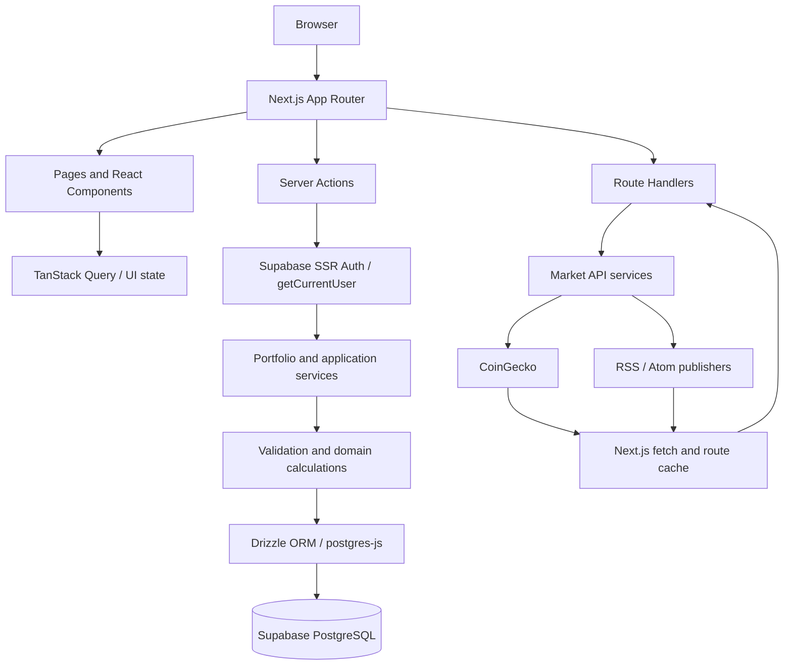

# System Architecture

## 1. Purpose and scope

Crypto Portfolio Tracker is a non-custodial portfolio-management and market-
information application. It records user-entered positions and transaction
history, obtains market information from external providers, and derives
portfolio summaries and analytics. It is not an exchange, wallet, broker, or
trade-execution system.

The application is a Next.js App Router application. The browser-facing UI,
server-rendered pages, Route Handlers, and Server Actions live in one deployable
application. Supabase provides authentication and PostgreSQL hosting. Drizzle
ORM and `postgres` provide typed server-side database access.

## 2. Logical architecture

The diagram shows logical responsibilities, not a deployment topology. In
particular, the browser does not connect directly to PostgreSQL.

## 3. Runtime responsibilities

### Presentation layer

- `src/app/` contains App Router pages, layouts, and Route Handlers.
- `src/components/` contains reusable UI and feature-specific components.
- Client Components own interaction state; Server Components and Server Actions
  are used for request-bound server work.
- The root route is `/`; feature routes include portfolio, analytics, markets,
  news, alerts, watchlist, settings, onboarding, login, and signup.

### Request boundary and authentication

- `src/proxy.ts` is the Next.js request-interception entry point in the current
  Next.js 16 application. Its matcher and exact redirects/session behaviour are
  defined by the implementation, not by this diagram.
- `src/lib/supabase/client.ts` (or the current browser helper) is for browser
  Supabase interactions.
- `src/lib/supabase/server.ts` creates a request-scoped server client using
  cookies. Do not reuse a cookie-bound server client as a process singleton.
- `src/lib/auth/get-current-user.ts` verifies the current Supabase user and
  exposes a request-cached identity/profile lookup.

### Application and domain layer

- `src/lib/actions/` contains authenticated mutation entry points.
- `src/lib/portfolio/` contains portfolio queries, decimal helpers, ledger
  replay, locking, and holding-projection recomputation.
- `src/lib/analytics/` contains pure calculations over already-loaded data.
- `src/lib/api/` contains external market-data/news adapters and normalizers.
- `src/types/` and `src/utils/` hold shared domain types and presentation helpers.

Domain calculations should remain independent from React and HTTP. Database
writes should remain inside server-side actions/services and database
transactions.

### Persistence layer

- `src/db/schema.ts` is the Drizzle schema source of truth.
- `drizzle/` contains versioned SQL migrations and snapshots.
- `src/lib/db/` creates the server-side PostgreSQL/Drizzle client.
- Supabase Auth owns user identity; application-owned profile and portfolio
  records reference the Supabase auth user ID.

**Important privilege boundary:** the configured Drizzle database connection
uses a privileged PostgreSQL role that can bypass Row Level Security. RLS is
still important for Supabase-authenticated access, but it is not a substitute
for application authorization on the privileged connection. Every user-facing
Drizzle query must include explicit owner scope derived from the verified
session. See [RLS and privileges](../database/rls-and-privileges.md).

## 4. Market-data boundary

Market-data calls are made server-side. The CoinGecko adapter centralizes the
base URL, optional Demo API key, upstream request construction, caching, and
error normalization. Route Handlers normalize provider responses into the
application's market types. The RSS aggregator fetches multiple feeds,
normalizes RSS/Atom entries, removes duplicate article URLs, and sorts the
combined feed.

The market routes expose a consistent response envelope and can return local
fallback data when the upstream source is unavailable. The `meta.source` value
must be checked by clients and operators; a successful HTTP response does not
necessarily mean the data came from a live upstream provider.

## 5. Caching and consistency

There are distinct cache layers:

1. Next.js server-side fetch revalidation for upstream market requests.
2. Route Handler revalidation for the public market endpoints.
3. Client-side query caching where a component uses TanStack Query.

The route-level windows are documented in the [API reference](../api/reference.md).
Do not share-cache user-specific portfolio or profile responses. Market data is
public and may be cached; user data must remain scoped to the authenticated user.

Portfolio consistency is handled transactionally. A ledger mutation locks the
owning portfolio row, writes the event, replays the ordered ledger, and updates
or deletes the derived holding projection before commit. A replay error aborts
the transaction. See [Ledger accounting](../database/ledger-accounting.md).

## 6. Architecture rules

1. Browser input is untrusted. Validate it at the server boundary.
2. Derive user identity from the verified Supabase session; never trust a
   submitted `userId` or `portfolioId` as proof of ownership.
3. Keep service credentials and `DATABASE_URL` server-only.
4. Keep financial rules in pure domain functions and test them independently.
5. Treat the transaction ledger as the authority and holdings as a projection.
6. Keep ledger insertion/deletion and projection recomputation in one DB
   transaction under the portfolio lock.
7. Use migrations for schema changes. Do not make unreviewed production schema
   edits or replace migration history with a schema push.
8. Keep provider adapters replaceable; do not bind UI components to provider
   response shapes.

## 7. Current boundaries and non-goals

The current application does not document a separate microservice tier, a
public REST API for portfolio mutations, exchange trade execution, wallet key
custody, or a durable historical portfolio-snapshot service. Future additions
must be reflected in this architecture after they exist in code and have tests.
