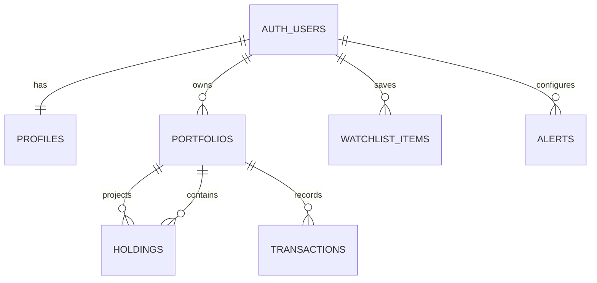

# Database Schema Reference

## 1. Database ownership

Supabase PostgreSQL stores authentication identities in `auth.users` and
application records in the `public` schema. Application tables use UUID keys.
User-owned rows carry `user_id` (or, for profiles, `id`) linked to the
Supabase-authenticated user.

The Drizzle declarations in `src/db/schema.ts` are the application schema
source of truth. SQL changes are generated into `drizzle/` and applied through
the migration runner. The production database should not be modified by an
unreviewed schema push.

## 2. Entity relationship overview

The `holdings` and `transactions` rows also carry `user_id`. Their composite
portfolio/user foreign-key relationship prevents a row from associating one
user with another user's portfolio. The exact constraints and names are
maintained in `src/db/schema.ts` and the SQL migrations.

## 3. Tables

### `profiles`

One application profile per Supabase auth user.

| Column | Meaning |
|---|---|
| `id` | Primary key; references `auth.users.id` |
| `display_name` | Optional display name |
| `avatar_url` | Optional avatar URL |
| `currency` | User display-currency preference; defaults to USD |
| `onboarded_at` | Null until onboarding is complete |
| `created_at` | Profile creation timestamp |

The profile trigger provisions the profile when an auth user is created.

### `portfolios`

A user's named portfolio container. The model permits multiple portfolios per
user even where the current action flow resolves a default portfolio.

| Column | Meaning |
|---|---|
| `id` | UUID primary key |
| `user_id` | Owner; references `auth.users.id` |
| `name` | Portfolio name |
| `description` | Optional description |
| `created_at` | Creation timestamp |
| `updated_at` | Last update timestamp |

### `holdings`

A current position projection. The transaction ledger, not this table, is the
accounting source of truth.

| Column | Meaning |
|---|---|
| `id` | UUID primary key |
| `portfolio_id` | Owning portfolio |
| `user_id` | Owner scope |
| `coin_id` | Provider asset identifier (for example, CoinGecko ID) |
| `symbol` | Display ticker |
| `quantity` | Current quantity, `NUMERIC(28,8)` |
| `cost_basis` | Average acquisition cost per unit, `NUMERIC(20,8)` |
| `created_at`, `updated_at` | Record timestamps |

A unique constraint on `(portfolio_id, coin_id)` allows one current projection
per asset per portfolio.

### `transactions`

The authoritative transaction/event ledger.

| Column | Meaning |
|---|---|
| `id` | UUID primary key |
| `ledger_sequence` | Database-generated unique integer used to break timestamp ties |
| `portfolio_id` | Owning portfolio |
| `user_id` | Owner scope |
| `coin_id` | Asset identifier |
| `symbol` | Display ticker stored with the event |
| `type` | `buy`, `sell`, or `adjustment` |
| `quantity` | Event quantity, `NUMERIC(28,8)` |
| `price_per_unit` | Unit execution/corrected basis, `NUMERIC(20,8)` |
| `total_value` | Recorded event value, `NUMERIC(48,16)` |
| `executed_at` | Effective event timestamp |
| `notes` | Optional user/system note |

Important constraints:

- `transactions_type_check` restricts the supported event types.
- `transactions_quantity_check` requires positive BUY/SELL quantities and
  allows zero only for ADJUSTMENT.
- `transactions_nonnegative_values_check` prevents negative price and total.
- `transactions_ledger_sequence_unique` guarantees unique sequence values.
- `transactions_ledger_replay_idx` supports scoped ordered replay.

### `watchlist_items`

A user-owned list of tracked assets, independent from portfolio ownership.

| Column | Meaning |
|---|---|
| `id` | UUID primary key |
| `user_id` | Owner |
| `coin_id` | Asset identifier |
| `symbol` | Display ticker |
| `added_at` | Add timestamp |

A unique constraint on `(user_id, coin_id)` prevents duplicate entries for the
same user. The add action uses conflict-safe insertion to handle races.

### `alerts`

A user-owned price-alert configuration.

| Column | Meaning |
|---|---|
| `id` | UUID primary key |
| `user_id` | Owner |
| `coin_id` | Asset identifier |
| `symbol` | Display ticker |
| `condition` | Threshold direction (`above` or `below`) |
| `target_price` | Threshold, `NUMERIC(20,8)` |
| `enabled` | Whether the alert is enabled |
| `created_at` | Creation timestamp |

The table documents the stored alert configuration. Any separate polling,
delivery, email, or push-notification worker must be documented independently
once it is present and deployed.

## 4. Relationships and delete behaviour

- Deleting a Supabase auth user cascades to the user's application-owned rows
  where configured by the foreign keys.
- Deleting a portfolio cascades to its holdings and transactions where the
  schema specifies that relationship.
- The explicit delete-holding action intentionally removes the holding and
  related ledger entries for that coin/portfolio. This is a destructive user
  operation and differs from recording an adjustment with quantity zero.
- Watchlist and alert records are user-owned and are not tied to a portfolio.

Review the live FK definitions and migrations before changing cascade rules.

## 5. Numeric conventions

| Data | Precision |
|---|---|
| Holding/transaction quantity | `NUMERIC(28,8)` |
| Holding cost basis | `NUMERIC(20,8)` |
| Transaction unit price | `NUMERIC(20,8)` |
| Transaction total value | `NUMERIC(48,16)` |
| Alert target price | `NUMERIC(20,8)` |

Do not replace financial `NUMERIC` columns with floating-point types. See
[Ledger accounting](ledger-accounting.md) for calculations and rounding rules.

## 6. Ownership and row-level security

RLS is enabled on the six application tables. Policies scope profiles by
`auth.uid() = id` and other user-owned records by `auth.uid() = user_id`, with
appropriate `USING` and/or `WITH CHECK` clauses for the operation.

The direct Drizzle connection uses a privileged database role and can bypass
RLS. Every user-facing query on that connection must therefore repeat explicit
ownership predicates. See [RLS and privileges](rls-and-privileges.md).
